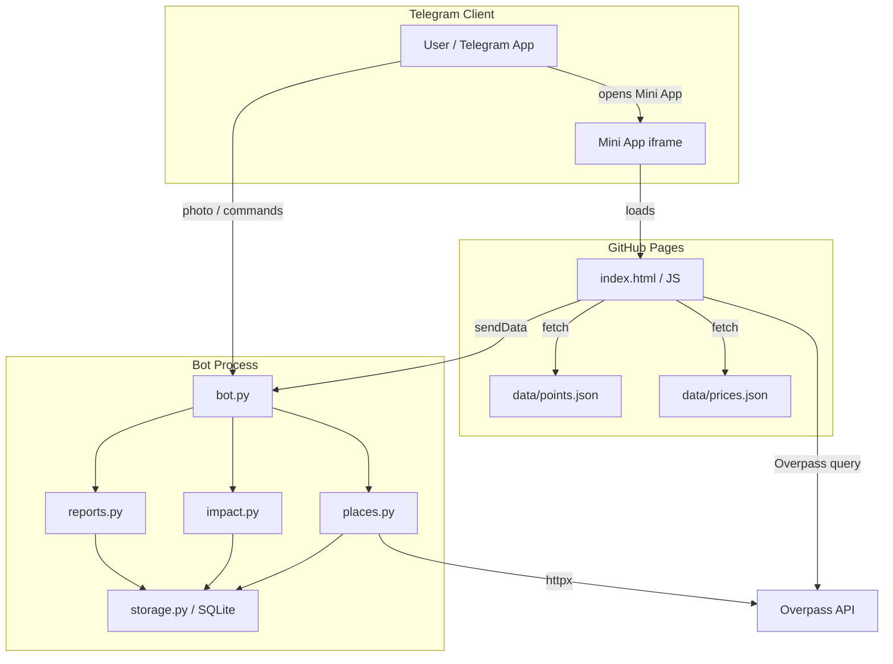
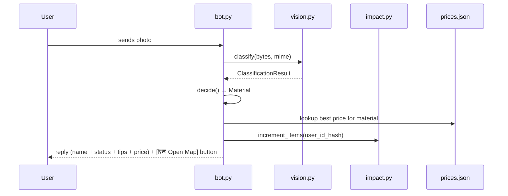
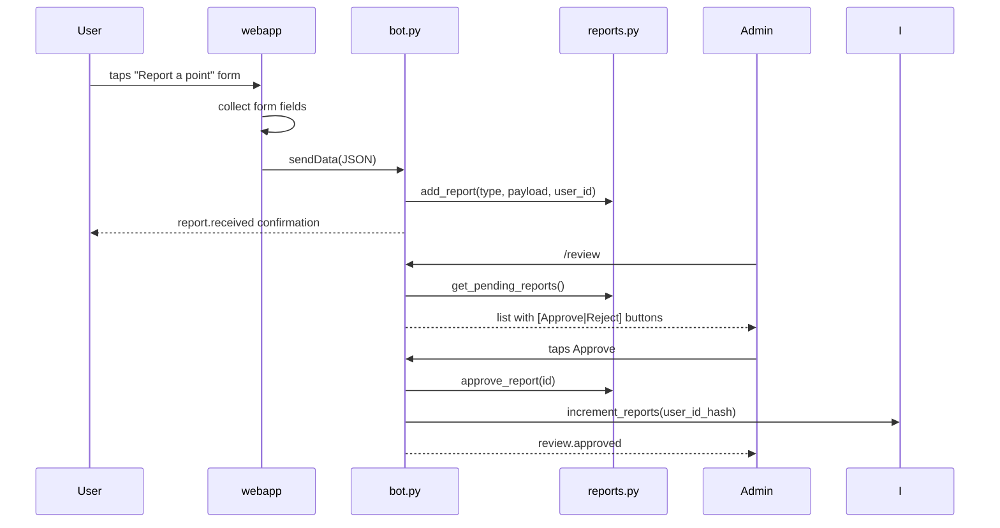

# Design — mini-app

## Review corrections (take precedence over everything else in this spec)

1. **Reports open from a keyboard button.** `Telegram.WebApp.sendData` works only when the Mini App is launched
   from a reply-keyboard button, not from the menu button or an inline button. Add a `/report` command that shows a
   `KeyboardButton(web_app=...)` opening `#report`. The report forms live on that screen. In the tabs, "Report"
   links explain this and send the user to `/report` instead of calling `sendData`.
2. **No backend for the Me tab.** The site is static and cannot read SQLite. The bot passes display values in the URL
   hash of the buttons it creates, e.g. `#me?items=3&reports=1&rank=7`. Without values the Me tab invites the
   user to send `/stats`. The leaderboard is shown by `/stats` in the bot; remove `data/leaderboard.json`.
3. **Overpass.** Browsers forbid setting `User-Agent`: do not set it in `map.js`; `places.py` keeps it. Try
   `https://overpass-api.de/api/interpreter`, then `https://maps.mail.ru/osm/tools/overpass/api/interpreter`.
   Query `nwr["amenity"="recycling"]` and `nwr["shop"="scrap"]` with `out center`, never `shop=second_hand`.
4. **Do not hide points with unknown materials.** Most Uzbek points have no `recycling:*` tags. Show them with a
   "materials unknown, call first" label below the points that are known to accept the material.
5. **`ADMIN_USER_ID` is optional** (default 0 = `/review` disabled). A missing value must not stop the bot.
6. **`WEBAPP_URL` is optional.** If it is empty or not `https://`, omit every Mini App button and the menu button.
7. **Hashing.** Plain SHA-256 of a Telegram id can be reversed by brute force. Use HMAC-SHA256 keyed with the bot
   token and do not claim it is irreversible. The leaderboard shows a friendly alias such as "Recycler #A1F3".
8. **Fair points.** At most 20 sorted items per user per day count towards points.
9. **Stale prices.** A price older than 60 days is labelled "may be outdated". Example values in this document are
   illustrative only: `points.json` and `prices.json` ship as `[]`.
10. **Location.** The Map tab uses Telegram `LocationManager` when available, then `navigator.geolocation`, then lets the
    user pick a city (Tashkent, Ohangaron, Samarkand) or tap the map.
11. **Scan tab.** A Mini App cannot send a photo to the bot: the Scan tab shows a short guide and a button
    that calls `Telegram.WebApp.close()` so that the user sends the photo in the chat.
12. **Localised levels.** Level names come from the locale files and `i18n.js`, not hard-coded English strings.

---

## Overview

This spec adds the Telegram Mini App (`webapp/`), two new backend modules (`places.py`, `impact.py`),
a community-reporting module (`reports.py`), and all the bot additions that tie them together.

The mini-app is a static single-page application (HTML + CSS + vanilla JS, no build step) published via
GitHub Pages at `WEBAPP_URL`. It has four tabs: **Scan**, **Map**, **Prices**, and **Me**. Users never
leave Telegram; the Mini App opens inside the Telegram client through the persistent menu button or the
inline "🗺 Open Map" button that the bot attaches to classification results.

The backend grows three new Python modules:
- `places.py` — Overpass queries, distance sort, SQLite cache.
- `impact.py` — item counter, level logic, leaderboard.
- `reports.py` — pending-report storage, `/review` admin flow.

Existing modules (`bot.py`, `storage.py`, `config.py`) are extended, not replaced.

---

## Architecture

The feature spans three layers:

1. **Static Mini App** (`webapp/`) — HTML/CSS/JS served from GitHub Pages. Reads curated JSON data files,
   queries Overpass directly from the browser, and communicates with the bot via
   `Telegram.WebApp.sendData()` for reports and `Telegram.WebApp.initDataUnsafe` for identity.
2. **Python backend** — three new modules (`places.py`, `impact.py`, `reports.py`) plus extensions to
   `bot.py`, `storage.py`, and `config.py`. Runs inside the same single-process async Telegram polling
   loop as the core bot.
3. **Curated data files** (`webapp/data/points.json`, `webapp/data/prices.json`) — static JSON committed to
   the repository, updated by the admin after reviewing community reports, and served via GitHub Pages.



---

## Components and Interfaces

### `places.py`

```python
def build_overpass_query(lat: float, lon: float, radius_m: int, osm_tag: str) -> str: ...
def haversine(lat1: float, lon1: float, lat2: float, lon2: float) -> float: ...
def sort_by_distance(
    points: list[dict], origin_lat: float, origin_lon: float
) -> list[dict]: ...
async def fetch_nearby(
    lat: float, lon: float, material_key: str, radius_m: int = 5000
) -> list[dict]: ...
```

`sort_by_distance` is a pure function that adds `distance_m` to each point dict and returns a new list
sorted ascending. `fetch_nearby` coordinates the cache check, Overpass call, and result persistence.

### `impact.py`

```python
LEVELS: list[tuple[int, str]]  # threshold → label pairs

def hash_user_id(user_id: int) -> str: ...
def total_points(items_sorted: int, approved_reports: int) -> int: ...
def get_level(points: int) -> str: ...
def increment_items(user_id_hash: str, n: int = 1) -> None: ...
def increment_reports(user_id_hash: str, n: int = 1) -> None: ...
def get_stats(user_id_hash: str) -> dict: ...
def get_leaderboard(limit: int = 10) -> list[dict]: ...
```

`total_points` and `get_level` are pure functions. The storage helpers call through to `storage._conn`.

### `reports.py`

```python
def add_report(type_: str, payload: dict, user_id: int) -> int: ...
def get_pending_reports() -> list[dict]: ...
def approve_report(report_id: int) -> dict: ...
def reject_report(report_id: int) -> None: ...
```

### `bot.py` additions

```python
async def web_app_data_handler(update: Update, context: ContextTypes.DEFAULT_TYPE) -> None: ...
async def review_handler(update: Update, context: ContextTypes.DEFAULT_TYPE) -> None: ...
async def review_callback_handler(update: Update, context: ContextTypes.DEFAULT_TYPE) -> None: ...
async def stats_handler(update: Update, context: ContextTypes.DEFAULT_TYPE) -> None: ...
async def location_handler(update: Update, context: ContextTypes.DEFAULT_TYPE) -> None: ...
```

### `config.py` addition

```python
admin_user_id: int  # required — read from ADMIN_USER_ID env var
```

### Mini App JS components

| File | Responsibility |
|---|---|
| `app.js` | Telegram.WebApp init, theme params, tab router, language switcher |
| `i18n.js` | `t(key, params)` function; all UI strings in uz/ru/en |
| `map.js` | Leaflet map, Overpass fetch, points.json merge, markers, popups |
| `prices.js` | prices.json fetch, table render, "Report price" links |
| `me.js` | stats display, level badge, leaderboard, "Report a point" link |

---

## Data Models

### `Point` (webapp/data/points.json entries)

| Field | Type | Required | Description |
|---|---|---|---|
| `id` | string | ✓ | Stable unique identifier (e.g. `"cp-001"`) |
| `name` | string | ✓ | Display name of the collection point |
| `lat` | number | ✓ | Latitude in decimal degrees |
| `lon` | number | ✓ | Longitude in decimal degrees |
| `materials` | string[] | ✓ | List of accepted material keys from CATALOGUE |
| `phone` | string | — | Contact phone number |
| `hours` | string | — | Opening hours (free text) |
| `source` | string | ✓ | How the data was obtained (e.g. `"field_survey"`) |
| `verified_date` | string | ✓ | ISO-8601 date of last verification |

### `PriceRecord` (webapp/data/prices.json entries)

| Field | Type | Required | Description |
|---|---|---|---|
| `point_id` | string | ✓ | References a `Point.id` |
| `material` | string | ✓ | Material key from CATALOGUE |
| `price_som_per_kg` | number | ✓ | Price in Uzbek som per kilogram |
| `source` | string | ✓ | How the price was verified |
| `date` | string | ✓ | ISO-8601 date when the price was confirmed |

### `Report` (SQLite `reports` table)

| Column | Type | Description |
|---|---|---|
| `id` | INTEGER PK | Auto-increment |
| `type` | TEXT | `'point'` or `'price'` |
| `payload` | TEXT | JSON string of form fields |
| `user_id_hash` | TEXT | SHA-256 of Telegram user_id |
| `status` | TEXT | `'pending'`, `'approved'`, or `'rejected'` |
| `created_at` | TEXT | ISO-8601 UTC timestamp |
| `reviewed_at` | TEXT | NULL until reviewed |

### `ImpactRow` (SQLite `impact` table)

| Column | Type | Description |
|---|---|---|
| `user_id_hash` | TEXT PK | SHA-256 of Telegram user_id |
| `items_sorted` | INTEGER | Number of photos classified |
| `approved_reports` | INTEGER | Number of community reports approved |

### `OverpassCacheRow` (SQLite `overpass_cache` table)

| Column | Type | Description |
|---|---|---|
| `cache_key` | TEXT PK | `"{lat:.3f},{lon:.3f},{material_key}"` |
| `payload` | TEXT | JSON string of parsed result list |
| `fetched_at` | TEXT | ISO-8601 UTC; entries expire after 24 hours |

---

## Error Handling

### Overpass unavailable

`fetch_nearby` catches `httpx.TimeoutException` and `httpx.HTTPStatusError`. On error it logs a warning
and returns an empty list rather than propagating the exception. The bot omits the "nearest point" line
from the reply silently.

### Malformed report payload from Mini App

`web_app_data_handler` validates the JSON structure before calling `reports.add_report`. If required
fields are missing it replies with `report.invalid` (a new locale key) and does not insert a row.

### `/review` from non-admin user

`review_handler` checks `update.effective_user.id == settings.admin_user_id`. If the check fails it
returns without replying (silent rejection; no information leak about whether the command exists).

### prices.json / points.json parse error

The startup smoke test (`--check` flag) fails fast with exit code 1 and a descriptive message if either
data file is missing or invalid JSON. During normal operation, `json.loads` errors are caught and logged;
the bot returns an empty price/no nearest-point gracefully.

---

## Testing Strategy

### Unit testing approach

Each new module has a dedicated test file. External services (Overpass via `httpx`, SQLite) are injected
as mocks or replaced with in-memory equivalents.

- `test_places.py`: `haversine` correctness, `sort_by_distance` ordering, cache hit/miss paths.
- `test_impact.py`: `total_points` identity, `get_level` boundary conditions, storage round-trips.
- `test_reports.py`: insert/approve/reject lifecycle, hash verification.
- `test_bot.py` additions: new handler stubs, admin guard on `/review`.

### Property-based testing approach

**Property test library**: `hypothesis` (already a dev dependency).

Property tests target pure functions with large or continuous input spaces:

| Property | Function under test | Generator |
|---|---|---|
| Sort is non-decreasing | `sort_by_distance` | `st.lists(st.tuples(lat, lon))` |
| Points maths identity | `total_points` | `st.integers(min_value=0)` × 2 |
| Level always valid | `get_level ∘ total_points` | same |
| Price lookup completeness | price lookup helper | `st.sampled_from(CATALOGUE keys)` |
| User_id always hashed | `hash_user_id` | `st.integers(min_value=1)` |

### Startup smoke test

`python -m qayta --check` verifies settings validation, DB schema creation (all five tables), and
`points.json` / `prices.json` parseability. Exits 0 on success, 1 with a descriptive message on failure.

### Integration approach

All Telegram, Gemini, and Overpass calls are mocked in tests. No live network access is required.

---

## Directory layout additions

```
qayta/
├── webapp/
│   ├── index.html          # single-page shell with four-tab bottom bar
│   ├── style.css           # dark-green design system, CSS custom properties
│   ├── app.js              # tab router, Telegram.WebApp init
│   ├── i18n.js             # mirrors locales key structure; uz/ru/en strings
│   ├── map.js              # Map tab: Leaflet, Overpass, curated points merge
│   ├── prices.js           # Prices tab: table rendering
│   ├── me.js               # Me tab: stats, level badge, leaderboard
│   └── data/
│       ├── points.json     # curated collection points (starts as [])
│       └── prices.json     # verified prices (starts as [])
├── src/qayta/
│   ├── places.py           # NEW: Overpass + distance sort + SQLite cache
│   ├── impact.py           # NEW: counters, level logic, leaderboard
│   └── reports.py          # NEW: pending reports + /review flow
└── tests/
    ├── test_places.py
    ├── test_impact.py
    └── test_reports.py
```

---

## Data schemas

### `webapp/data/points.json`

Array of curated collection-point objects. Starts as `[]`.

```json
[
  {
    "id": "cp-001",
    "name": "Tashkent Recycling Centre",
    "lat": 41.2995,
    "lon": 69.2401,
    "materials": ["PET_1", "HDPE_2", "PAPER"],
    "phone": "+998901234567",
    "hours": "Mon–Sat 09:00–18:00",
    "source": "field_survey",
    "verified_date": "2025-01-15"
  }
]
```

### `webapp/data/prices.json`

Array of verified price records. Starts as `[]`.

```json
[
  {
    "point_id": "cp-001",
    "material": "PET_1",
    "price_som_per_kg": 1200,
    "source": "phone_call",
    "date": "2025-01-15"
  }
]
```

### SQLite table: `reports`

```sql
CREATE TABLE IF NOT EXISTS reports (
    id            INTEGER PRIMARY KEY AUTOINCREMENT,
    type          TEXT    NOT NULL,          -- 'point' | 'price'
    payload       TEXT    NOT NULL,          -- JSON string of form fields
    user_id_hash  TEXT    NOT NULL,          -- SHA-256 hex of raw Telegram user_id
    status        TEXT    NOT NULL DEFAULT 'pending',  -- 'pending' | 'approved' | 'rejected'
    created_at    TEXT    NOT NULL,          -- ISO-8601 UTC timestamp
    reviewed_at   TEXT                       -- NULL until reviewed
);
```

### SQLite table: `impact`

```sql
CREATE TABLE IF NOT EXISTS impact (
    user_id_hash  TEXT    PRIMARY KEY,
    items_sorted  INTEGER NOT NULL DEFAULT 0,
    approved_reports INTEGER NOT NULL DEFAULT 0
);
```

### SQLite table: `overpass_cache`

```sql
CREATE TABLE IF NOT EXISTS overpass_cache (
    cache_key     TEXT    PRIMARY KEY,   -- "{lat:.3f},{lon:.3f},{material_key}"
    payload       TEXT    NOT NULL,      -- JSON string of parsed result list
    fetched_at    TEXT    NOT NULL       -- ISO-8601 UTC; expire after 24 h
);
```

---

## Module designs

### `places.py`

Responsible for finding nearby collection points that accept a given material.

**Overpass query builder**

```python
def build_overpass_query(lat: float, lon: float, radius_m: int, osm_tag: str) -> str:
    """Return an Overpass QL query string for recycling nodes/ways near a point."""
```

Uses the `out body;` output format and includes `[out:json]`. Queries
`node[amenity=recycling][{osm_tag}=yes]` and `node[shop=second_hand]` within `radius_m` metres.

**`async def fetch_nearby(lat, lon, material_key, radius_m=5000) -> list[dict]`**

1. Compute `cache_key = f"{lat:.3f},{lon:.3f},{material_key}"`.
2. Check `overpass_cache` — if a row exists and `fetched_at` is within 24 hours, return the cached payload.
3. Otherwise call Overpass via `httpx.AsyncClient` with:
   - `User-Agent: "Qayta-bot/1.0 (+https://github.com/qayta)"` 
   - Timeout: 25 seconds.
   - One request at a time (the caller serialises; no semaphore needed in the single-process bot).
4. Parse the JSON response, extract node `lat`, `lon`, `tags`.
5. Compute distance for each node (Haversine), sort ascending.
6. Write result to cache; return list of dicts with keys: `lat`, `lon`, `name`, `distance_m`.

**`def haversine(lat1, lon1, lat2, lon2) -> float`**

Pure function. Returns distance in metres using the Haversine formula.

**`def sort_by_distance(points: list[dict], origin_lat: float, origin_lon: float) -> list[dict]`**

Pure function. Adds a `distance_m` key to each dict and returns a new list sorted ascending by distance.
Suitable for property-based testing.

---

### `impact.py`

Counters, level labels, and leaderboard logic. All functions are pure except the storage helpers.

**Level table**

```python
LEVELS: list[tuple[int, str]] = [
    (0,   "Beginner"),
    (10,  "Recycler"),
    (50,  "Champion"),
    (100, "Legend"),
]
```

**`def total_points(items_sorted: int, approved_reports: int) -> int`**

```python
return items_sorted + 5 * approved_reports
```

**`def get_level(points: int) -> str`**

Walks `LEVELS` in reverse; returns the label for the highest threshold ≤ `points`.

**`def increment_items(user_id_hash: str, n: int = 1) -> None`**

Upserts a row in `impact` table: `items_sorted += n`.

**`def increment_reports(user_id_hash: str, n: int = 1) -> None`**

Upserts a row in `impact` table: `approved_reports += n`.

**`def get_stats(user_id_hash: str) -> dict`**

Returns `{"items_sorted": int, "approved_reports": int, "points": int, "level": str}`.

**`def get_leaderboard(limit: int = 10) -> list[dict]`**

Returns top `limit` rows ordered by `items_sorted + 5 * approved_reports` descending.
Each entry: `{"user_id_hash": str, "points": int, "level": str}`.

**`def hash_user_id(user_id: int) -> str`**

`hashlib.sha256(str(user_id).encode()).hexdigest()`

---

### `reports.py`

Stores community reports and drives the `/review` admin flow.

**`def add_report(type_: str, payload: dict, user_id: int) -> int`**

Hashes the user ID, inserts a `pending` row, returns the new report `id`.

**`def get_pending_reports() -> list[dict]`**

Returns all rows where `status = 'pending'`, ordered by `created_at` ascending.

**`def approve_report(report_id: int) -> dict`**

Sets `status = 'approved'`, sets `reviewed_at`. Returns the report row (for the admin to act on it).

**`def reject_report(report_id: int) -> None`**

Sets `status = 'rejected'`, sets `reviewed_at`.

**Report payload schemas**

Point report:
```json
{ "name": "string", "lat": 1.23, "lon": 4.56, "materials": ["PET_1"],
  "phone": "optional", "hours": "optional" }
```

Price report:
```json
{ "point_id": "cp-001", "material": "PET_1", "price_som_per_kg": 1200 }
```

---

### `config.py` additions

New field:

```python
admin_user_id: int  # ADMIN_USER_ID env var — required
```

---

### `storage.py` additions

`init_db` gains three new `CREATE TABLE IF NOT EXISTS` statements for `reports`, `impact`, and
`overpass_cache`. No other changes to the public API.

---

### `bot.py` additions

**`web_app_data_handler`** — triggers on `MessageHandler(filters.StatusUpdate.WEB_APP_DATA)`:
1. Parse `update.message.web_app_data.data` as JSON.
2. Validate `type` is `"point"` or `"price"` and required fields exist.
3. Call `reports.add_report(...)`.
4. Reply with a localised confirmation (`report.received`).

**`review_handler`** — `/review` command restricted to `ADMIN_USER_ID`:
1. Fetch pending reports via `reports.get_pending_reports()`.
2. If none, reply with `review.none_pending`.
3. For each report, send a message with the payload and an `InlineKeyboardMarkup` containing
   `[Approve ✅ | Reject ❌]` buttons with `callback_data="review_approve_{id}"` / `"review_reject_{id}"`.

**`review_callback_handler`** — `CallbackQueryHandler` matching `^review_(approve|reject)_\d+$`:
1. Parse action and report ID.
2. Call `reports.approve_report(id)` or `reports.reject_report(id)`.
3. On approve: increment `impact.increment_reports` for the reporter; edit the message to show
   `review.approved`.
4. On reject: edit to show `review.rejected`.

**`stats_handler`** — `/stats` command:
1. Hash the user ID.
2. Call `impact.get_stats(hash)`.
3. Format and reply with `stats.result`.

**Extended `classify_and_reply`**:
- After a successful classification, load `webapp/data/prices.json` and look up the best price for the
  material.
- If the user's last known location is stored (see below), look up the nearest point from `places.py`.
- Append a "💰 Best price: X so'm/kg (source, date)" line when available, or omit silently.
- Append an inline button "🗺 Open Map" with `web_app` URL `{WEBAPP_URL}#map?material={KEY}`.
- Increment `impact.increment_items(user_id_hash)`.

**`location_handler`** — `MessageHandler(filters.LOCATION)`:
- Stores `(lat, lon)` in `context.user_data["last_location"]` (in-memory, not persisted to DB).

**Menu button**: set in `__main__.py` via `app.bot.set_chat_menu_button(menu_button=MenuButtonWebApp(...))`.

---

## Web app (`webapp/`) design

### `index.html`

Single-page shell. Loads Leaflet CSS/JS from CDN, then `style.css`, `i18n.js`, `app.js`, `map.js`,
`prices.js`, `me.js`.

```html
<body>
  <div id="app">
    <main id="tab-content"></main>
    <nav id="bottom-bar">
      <button data-tab="scan">📸 Scan</button>
      <button data-tab="map">🗺 Map</button>
      <button data-tab="prices">💰 Prices</button>
      <button data-tab="me">👤 Me</button>
    </nav>
  </div>
</body>
```

### `style.css`

Uses CSS custom properties for the design system:

```css
:root {
  --color-primary: #1e7a4a;   /* dark green */
  --color-bg: #121212;
  --color-surface: #1e1e1e;
  --color-text: #f0f0f0;
  --color-accent: #4caf75;
  --radius: 12px;
  --tab-height: 56px;
}
```

Overrides Telegram theme params when provided:

```js
// in app.js
const tp = Telegram.WebApp.themeParams;
if (tp.bg_color) document.documentElement.style.setProperty('--color-bg', tp.bg_color);
```

Minimum viewport: 375 px. All tap targets ≥ 44 × 44 px.

### `i18n.js`

```js
const STRINGS = {
  uz: { "tab.scan": "Scan", "tab.map": "Xarita", ... },
  ru: { "tab.scan": "Сканировать", ... },
  en: { "tab.scan": "Scan", ... },
};

function t(key, params = {}) {
  const lang = localStorage.getItem('qayta_lang') || 'uz';
  let str = (STRINGS[lang] || STRINGS.en)[key] || key;
  for (const [k, v] of Object.entries(params)) str = str.replaceAll(`{${k}}`, v);
  return str;
}
```

### `map.js`

```
loadPoints() → fetch points.json + Overpass query → merge → sort by distance
renderMap()  → Leaflet map centred on user → addMarker() per point
addMarker()  → L.marker + popup (name, verified_date badge, price, phone, geo: link)
```

URL-hash routing: on `#map?material=PET_1`, the material selector pre-selects PET_1 and triggers a
filtered search automatically.

Overpass query runs client-side with `fetch()` and the same User-Agent header. Results are merged with
curated `points.json` entries (curated data takes precedence by `id`).

### `prices.js`

Fetches `data/prices.json`, groups by material, renders a `<table>` with columns:
`Material | Point | Price (so'm/kg) | Source | Date`. Rows with no price show "—" with a "Report price"
link.

### `me.js`

Reads stats from `Telegram.WebApp.initDataUnsafe` (when available) by calling the bot's `/stats`
command result stored in `user_data`, or falls back to reading `impact` data via a lightweight endpoint.

For the hackathon, stats are rendered from `initDataUnsafe.user` (user ID only) and a local fetch.
The leaderboard is rendered from `data/leaderboard.json` (generated by the bot periodically, or on
demand by the admin).

Levels and points maths are mirrored in `me.js` from `impact.py`:

```js
function getLevel(points) {
  if (points >= 100) return "Legend";
  if (points >= 50)  return "Champion";
  if (points >= 10)  return "Recycler";
  return "Beginner";
}

function totalPoints(itemsSorted, approvedReports) {
  return itemsSorted + 5 * approvedReports;
}
```

### `app.js`

Initialises `Telegram.WebApp`, sets theme, renders the active tab, handles bottom-bar navigation,
language switcher, and URL-hash routing.

```js
Telegram.WebApp.ready();
Telegram.WebApp.expand();
```

---

## Locale additions

All three locale files (`uz.json`, `ru.json`, `en.json`) gain these keys with identical sets:

```
map.title, map.choose_material, map.no_points, map.route,
map.verified_on, map.open_osm,
report.received, report.point_form, report.price_form,
review.none_pending, review.approved, review.rejected,
stats.result, stats.level, stats.items, stats.reports, stats.points,
stats.leaderboard,
impact.open_map_button,
cmd.review, cmd.stats
```

---

## Bot sequence diagrams

### Photo classification with price and map button



### Community report flow



---

## Test strategy

### `tests/test_places.py`

- **Unit:** `haversine(0, 0, 0, 0)` returns 0.
- **Unit:** `haversine` returns ~111 km for 1° latitude difference.
- **Unit:** `build_overpass_query` returns a string containing the expected `osm_tag`.
- **Unit:** `fetch_nearby` returns cached data without hitting Overpass (mock `httpx`).
- **Unit:** `fetch_nearby` calls Overpass when cache is stale (mock `httpx`).
- **Property (Hypothesis):** `sort_by_distance` result is non-decreasing by `distance_m` for any list of
  `(lat, lon)` pairs and any origin.

### `tests/test_impact.py`

- **Unit:** `total_points(0, 0) == 0`.
- **Unit:** `get_level(0) == "Beginner"`, `get_level(10) == "Recycler"`, boundary at 50 and 100.
- **Property (Hypothesis):** for any non-negative `(items_sorted, approved_reports)`:
  `total_points(i, r) == i + 5 * r` and `get_level(total_points(i, r))` is one of the four strings.
- **Unit:** `increment_items` then `get_stats` round-trips correctly (in-memory DB).

### `tests/test_reports.py`

- **Unit:** `add_report` inserts a pending row; `get_pending_reports` returns it.
- **Unit:** `approve_report` changes status to `approved`.
- **Unit:** `reject_report` changes status to `rejected`.
- **Unit:** `add_report` stores a hashed user_id (not the raw integer).

### `tests/test_bot.py` additions

- **Unit:** `web_app_data_handler` calls `reports.add_report` and replies with `report.received`.
- **Unit:** `review_handler` is rejected for non-admin users.
- **Unit:** `review_callback_handler` calls `approve_report` and `increment_reports` on approve action.
- **Unit:** `stats_handler` replies with the user's stats.
- **Unit:** `classify_and_reply` appends the map button after a successful classification.

### Startup smoke test

`python -m qayta --check`:
- Validates settings (raises on missing env vars, exits 1).
- Calls `storage.init_db()` (in-memory mode) — checks all tables are created.
- Loads `webapp/data/points.json` and `webapp/data/prices.json` — checks they are valid JSON arrays.
- Exits 0 on success.

---

## Privacy and security notes

- `user_id_hash` is SHA-256 of the Telegram integer ID string. It is not reversible given only the hash,
  but it is stable across sessions (same user always gets the same hash). No salt is added because the
  leaderboard needs stable identifiers, and Telegram user IDs are not secrets.
- Location data (`last_location` in `context.user_data`) is in-process memory only; never written to DB.
- The `/review` command checks `update.effective_user.id == settings.admin_user_id` before showing reports.
- Report payloads contain the form fields entered by the user; they do not include the user's Telegram name
  or photo.
- The Mini App JS never embeds the bot token, API keys, or the admin user ID.

---

## Correctness Properties

*A property is a characteristic or behavior that should hold true across all valid executions of a
system — essentially, a formal statement about what the system should do.*

### Property 1: Distance sort is non-decreasing

*For any* list of geographic points and any origin coordinate, after calling `sort_by_distance` the
resulting list has `points[i].distance_m <= points[i+1].distance_m` for all adjacent pairs.

**Validates: Requirements 9.1**

### Property 2: Points maths identity

*For any* non-negative integers `items_sorted` and `approved_reports`,
`total_points(items_sorted, approved_reports) == items_sorted + 5 * approved_reports`.

**Validates: Requirements 10.1**

### Property 3: Level is always a valid string

*For any* non-negative `items_sorted` and `approved_reports`,
`get_level(total_points(items_sorted, approved_reports))` is one of
`{"Beginner", "Recycler", "Champion", "Legend"}`.

**Validates: Requirements 10.2**

### Property 4: Price lookup returns None or a complete record

*For any* material key from the catalogue (including keys absent from `prices.json`), calling the price
lookup function returns either `None` or a dict containing all of `point_id`, `material`,
`price_som_per_kg`, `source`, and `date`.

**Validates: Requirements 8.1**

### Property 5: Report user_id is always stored hashed

*For any* Telegram integer `user_id`, the `user_id_hash` stored in the `reports` table equals
`sha256(str(user_id).encode()).hexdigest()` and never equals `str(user_id)`.

**Validates: Requirements 6.4**
